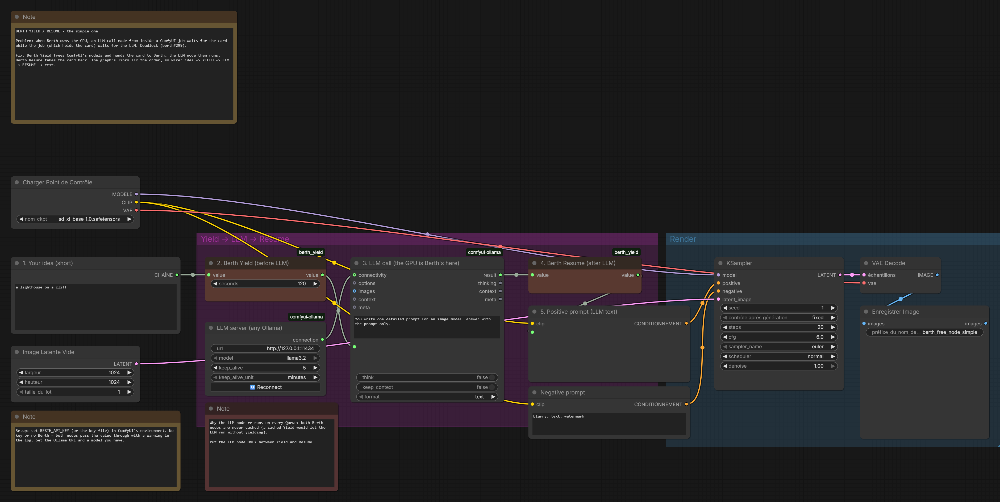
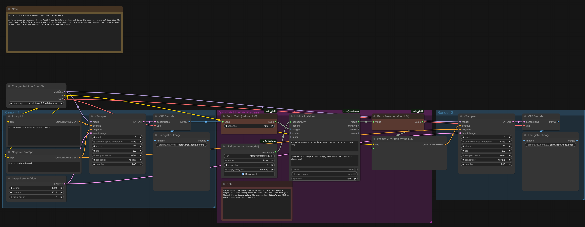

# comfyui-berth-yield

**Call an LLM from the middle of a ComfyUI workflow without deadlocking the GPU.**
Two small ComfyUI nodes, *Berth Yield (before LLM)* and *Berth Resume (after LLM)*, for setups where
[Berth](https://github.com/T-Crypt/berth) schedules the GPU between ComfyUI and your LLM server.

> **Unofficial.** This project is not affiliated with or endorsed by Berth or its author. It only talks to Berth's
> public HTTP gateway. All credit for Berth, and for the yield API these nodes use, goes to
> [T-Crypt](https://github.com/T-Crypt) (see [berth#299](https://github.com/T-Crypt/berth/issues/299), where the design
> came out of). Berth is Apache-2.0; so is this repository.



## Why

When Berth owns the GPU, a ComfyUI job that calls an LLM node halfway through is stuck in a circle:

1. the job holds the card and waits for the LLM's answer;
2. the LLM server waits for Berth to hand it the card;
3. Berth cannot take the card from ComfyUI before the job ends, because ComfyUI frees memory only between jobs.

Nothing moves until the LLM node's HTTP call times out and the workflow fails. This is the case described in
[berth#299](https://github.com/T-Crypt/berth/issues/299), and Berth's answer is the cooperative **yield** documented in
[`docs/leasing.md`](https://github.com/T-Crypt/berth/blob/main/docs/leasing.md) ("A yield"). These nodes are the client
side of it:

- **Berth Yield** frees ComfyUI's models in-process (`unload_all_models()` + `soft_empty_cache()`; `/free` would only
  act after the job), then calls `POST /v1/berth/yield {"engine": "comfyui", "seconds": N}`. While the yield lasts,
  Berth treats the running job as being at its boundary and can give the card to the LLM.
- **Berth Resume** calls `{"engine": "comfyui", "end": true}`. Berth answers once ComfyUI holds the card again, and
  the next nodes load their models back.

Wire them around any LLM node: `something -> Berth Yield -> LLM node -> Berth Resume -> rest of the graph`.
Both take any type and return it unchanged, so the links fix the order. They are never cached (a cached yield would
let the LLM run without one), so the LLM node between them re-runs on every queue.

## Install

```
cd ComfyUI/custom_nodes
git clone https://github.com/chapi456/comfyui-berth-yield
```

Restart ComfyUI. The nodes use only the Python standard library (nothing to `pip install`) and appear under
`utils/berth`.

Berth side (needs Berth 0.6 or later): ComfyUI's entry must be able to park (`keep_comfyui_up = true` in
`berth.toml`), otherwise the LLM's drain stops ComfyUI instead of parking it. See
[Berth's docs](https://github.com/T-Crypt/berth/tree/main/docs).

## Configuration

Environment of the ComfyUI process, never the graph:

| Variable | Default | |
| --- | --- | --- |
| `BERTH_URL` | `http://127.0.0.1:9799` | Berth gateway |
| `BERTH_API_KEY` | | the key (`berth key` prints it), or: |
| `BERTH_KEY_FILE` | `~/.config/berth/api.key` | a file holding the key |
| `BERTH_ENGINE` | `comfyui` | ComfyUI's entry name in `berth.toml` |

The only credential is Berth's API key. Nothing else is read, and nothing is sent anywhere but your Berth gateway.

Fail-safe by design: no key, Berth unreachable, a cut answer, `404` or `409` give a warning in ComfyUI's log, the value
passes through, and the workflow goes on as it would without Berth. Berth Resume ends only a yield its own Berth Yield
got. `seconds` on Berth Yield should be a little longer than your longest LLM call; if the workflow dies in the middle,
the yield ends by itself when that time runs out.

## Example workflows

Load them from ComfyUI (menu, *Open*, or drag the file onto the canvas). They are in the **UI graph format**, with notes
inside the graph; `workflows/berth_yield_vision_api.json` is the same idea in API format.

| File | What it does |
| --- | --- |
| [`workflows/berth_yield_simple.json`](workflows/berth_yield_simple.json) | **Start here.** A short idea goes through *Berth Yield*, an [Ollama](https://github.com/stavsap/comfyui-ollama) node expands it into a full prompt, *Berth Resume* takes the card back, then the render. |
| [`workflows/berth_yield_vision.json`](workflows/berth_yield_vision.json) | Render, *Berth Yield*, a vision LLM describes the image and rewrites it as a new prompt, *Berth Resume*, second render that follows it. |



They need [comfyui-ollama](https://github.com/stavsap/comfyui-ollama) for the LLM node (any LLM node works; the Berth
nodes do not care which). Set the checkpoint, the server URL (default `http://127.0.0.1:11434`) and a model you have.
To see what a yield did, run `berth why comfyui`: it prints the waits, drains and parks in order.

## Known limit: a cold LLM load can evict the parked ComfyUI

While the LLM runs, Berth keeps ComfyUI *parked* (its models are out of the card, the process stays up with a few hundred
MiB). If the LLM is loaded **cold** and its weights push the machine's free RAM under Berth's `[park] floor_gib`,
Berth evicts the parked engine, which stops ComfyUI. The job is then lost when Berth Resume runs ("prompt not in the
queue or history"). It is Berth's RAM guard, not the nodes, and it is deterministic on a machine where the LLM's
load alone crosses the floor: on a 12 GB card with 80 GB of RAM and `floor_gib = 8`, two runs out of two lost the job.
The yield itself worked each time (the card went from 9.8 GiB used to 138 MiB in about 3 s and the LLM was served).
The log of the failing cycles (`berth events`):

```
23:15:17  lease.draining   comfyui  strata (foreground) needs the card
23:15:19  lease.parked     comfyui  1350 MiB  residual 230 MiB
23:15:19  lease.granted    strata   beside parked comfyui (230 MiB)
23:16:26  lease.park_evicted comfyui 1350 MiB  available RAM is under the floor
```

What helps: keep the LLM warm (a longer `ttl`/idle unload on the LLM side), a lower `floor_gib` if your RAM allows it (with `floor_gib = 3` on the same machine the job survived the cold load in 10 runs out of 12, see below),
or an LLM whose load does not take the free RAM under the floor. An eviction here frees only the parked engine's
~230 MiB, which is why it cannot restore the floor.

Not done yet: a pre-check in the node ("is there enough free memory to start the LLM without evicting the parked
ComfyUI?"). Berth does not expose that answer over its HTTP API today (`berth fit` is CLI-only and says nothing about
RAM), and the node cannot know the engine's needs, so it would only be a guess. If Berth offers an admission query, the
node can ask it before yielding.

## Measured

RTX 4070 (12 GB), 80 GB RAM, Berth 0.6.1, an SDXL checkpoint and a local vision/text LLM (details in
[docs/measures.md](docs/measures.md)):

- **The yield itself:** card at 9.8 GiB used when Berth Yield runs, 138 MiB three seconds later (models freed in-process
  before the call), then the LLM loads on the freed card.
- **Full cycle, LLM warm in RAM:** render, Berth Yield, vision LLM, Berth Resume, second render: 98 s end to end,
  ComfyUI parked in 2 s, card returned in 0.35 s, the second render follows the LLM's prompt.
- **Full cycle, LLM loaded cold with `floor_gib = 8`:** the job was lost every time (4 runs out of 4), see the known
  limit above.
- **Same, with `floor_gib = 3`:** 12 runs through the job API (6 simple, 6 vision): 10 done in 89 to 259 s, ComfyUI
  parked in RAM during the LLM and resumed from RAM in under a second; 1 lost job (the LLM was still loading when
  ComfyUI asked for the card back, Berth could not unload it: `409` on the engine's unload, ComfyUI restarted) and 1
  refused at submission ("switch in progress", `503`, not related to the nodes).

## License

Apache-2.0, like Berth. See [LICENSE](LICENSE) and [NOTICE](NOTICE).
